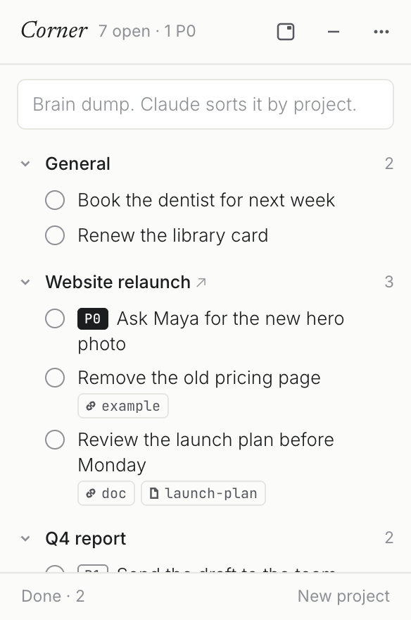
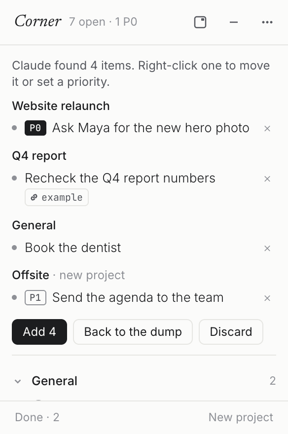
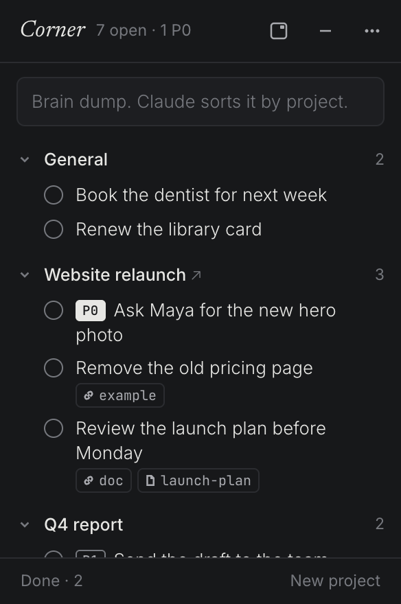

# Corner

A mini window for action items that stays on top of everything: the browser, the terminal, the editor, full-screen apps, every desktop. Items are grouped by project, with General first, and a project's name opens its dashboard. A brain dump becomes a clean list: Claude sorts it when Claude Code is installed, and project keywords sort it when it is not.

| The list | A brain dump, sorted | Dark |
|---|---|---|
|  |  |  |

Mini mode keeps only the bar:


## Install (macOS)

One line in Terminal installs it, and the same line updates it later. Updating keeps the list.

```
curl -fsSL https://raw.githubusercontent.com/abrilcode/corner/main/install.sh | bash
```

Corner opens straight away, opens at every login, and comes back each morning. The window can be hidden with **⌃⌥Space** (Control-Option-Space) or the icon in the menu bar.

<details>
<summary>Install without Terminal</summary>

1. Open the [latest release](https://github.com/abrilcode/corner/releases/latest) and download the `.dmg` for the Mac's chip: `arm64` for Apple silicon (M1 to M4), `x64` for Intel.
2. Open the dmg and drag Corner to Applications.
3. Open Corner. macOS blocks it the first time because the app is not notarised by Apple. Go to **System Settings > Privacy & Security**, scroll to "Corner was blocked", click **Open Anyway**, and confirm.

</details>

## With or without Claude Code

Everything works without Claude Code: projects, items, P0 and P1, links and dashboards. The only difference is how a brain dump is sorted.

| | Without Claude Code | With [Claude Code](https://claude.com/claude-code) |
|---|---|---|
| Brain dump | Split into lines and sentences, then filed by project names and keywords | Claude rewrites it as short actions, files each one, sets P0/P1 when the dump says so, and attaches the links mentioned |
| Claude Code chats | n/a | "add these to my corner: …", "what's open on Website?", "done with the Maya one" all work in any chat, through the `corner` skill that Corner installs |

Corner finds Claude Code by itself. If Claude Code is installed later, Claude sorting turns on at the next sort.

## Daily use

| | |
|---|---|
| Show or hide, with the cursor in the dump | **⌃⌥Space**, or the menu-bar icon |
| Sort a dump | type or paste in the box, **⌘↵**, check the proposal, **Add** |
| Add a dump line by line to General | **Add as is** (⇧⌘↵) |
| Add an item to a project | hover the project, **+** |
| Set a priority | start the text with `P0 ` or `P1 `, or right-click > Priority; click the tag to change it (P0 → P1 → none) |
| Start working on an item | hover it, **▶**: its circle spins, and the bar (mini mode too) shows it with the time spent. One at a time; **‖** or ticking it done stops it |
| Tick an item | click the circle; **Done** in the footer brings it back |
| Edit an item | double-click its text |
| Link a doc or a file | drag it from the Finder or a tab from the browser onto the item, or right-click > Add a link |
| Open a project's dashboard | click the project name (↗) |
| Add or edit a project (name, dashboard, keywords) | **New project** in the footer, or right-click a project > Edit project |
| Project IDs (for work setups that track one) | off by default; menu-bar icon > **Project IDs** adds an ID field to each project and a copy icon next to its name |
| Move the window | drag the bar (it sticks to the edges), or the corner button |
| Mini | the – button, or double-click the bar |

P0 items come first in each project, then P1, then the rest. Projects with nothing open fold away under **Quiet**. Keywords help both sorters: other names for the project, people and tools that point to it.

## Data and privacy

- The list is one file on the Mac: `~/.corner/corner.json`, plus `corner.json.bak`, the version before the last change. Corner has no server and no account.
- With Claude Code, **Sort with Claude** sends the dump, the project names and keywords and the open item titles to Claude through the Claude Code already installed and signed in on that Mac. It runs `claude -p` with every tool turned off. The keyword sorter never leaves the Mac.

## Update or remove

- Update: run the install line again.
- Remove: quit Corner from the menu-bar icon, delete `/Applications/Corner.app`, and optionally delete `~/.corner` (the list) and `~/.claude/skills/corner` (the skill).

## Build from source

```
npm install
npm test                 # unit tests
npm start                # run from source
npm run dist             # dist/Corner-mac-{arm64,x64}.{zip,dmg}
tools/e2e.sh             # drives the real window (one real Claude sort if Claude Code is installed)
tools/shot.sh review out.png [light|dark]
```

On a Mac without Node, `tools/build.sh` builds and installs the app with Electron's own runtime (the `tools/bin` shims). Pushing a tag such as `v1.2.0` builds and publishes a release on GitHub Actions.

MIT licence.
